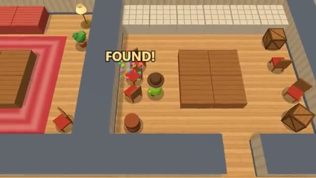

# Prop Hide

Be the lamp. Don't move. Don't squeak. A multiplayer starter game from [Multiplayer Agent](https://multiplayeragent.com): 3D, party, 3–10 players, with bots that fill empty seats.

## How it plays

Hiders turn into crates, lamps, plants and chairs and hide among the real ones while the seekers count. Seekers tap props to tag them: a hider is found and joins the seekers, a real prop leaves you dizzy for a moment. Find every hider before time runs out.

**Controls:** WASD to walk, click a prop to become it or tag it, Q change, R turn, or the touch stick and buttons.

## Make it yours in the Game Builder

Open the [Game Builder](https://multiplayeragent.com), choose **Start from a starter game** and pick Prop Hide. It opens as version 1 in your studio, ready to play and publish. Then ask for changes, for example:

- Set it in a spooky castle with suits of armor
- Let hiders throw a decoy that squeaks somewhere else
- Give seekers a radar that beeps faster near a hider

## Run it yourself

1. Get a free publishable key (`pk_…`) at [multiplayeragent.com](https://multiplayeragent.com).
2. In `index.html`, put it in place of `pk_REPLACE_ME` in the `MP_CONNECT` block.
3. Serve the folder (for example `npx serve`) and open it. The 3D engine loads as a module, which browsers block from a file on disk.

Without a key it still runs, offline against bots.

## How it is built

- One `index.html` plus three.js in `libs/`. The comment at the top of the script maps the code and explains the multiplayer.
- **Host-run rounds:** The host's browser picks the seekers, checks every tag and makes hiders squeak; if it leaves, the next player takes over.
- **Bots:** Bot hiders pick spots next to look-alikes; bot seekers search, listen and sometimes tag a real lamp.
- **Live sync:** Every prop, walker and squeak is the same for everyone.
- **Not secret:** Which prop is a player is in the room state, so someone digging in their browser's dev tools could spot the hiders. Play it fair.
- **Leaderboard:** The most points anyone scored in one round.
- `?attract` runs it offline with bots only. The preview video is recorded from it.

## License

MIT. three.js in `libs/` is MIT too (Copyright 2010-2024 three.js authors).
